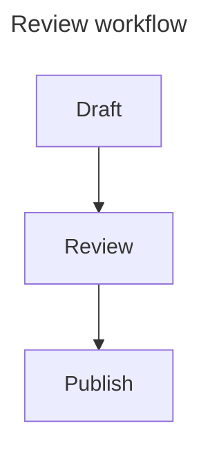
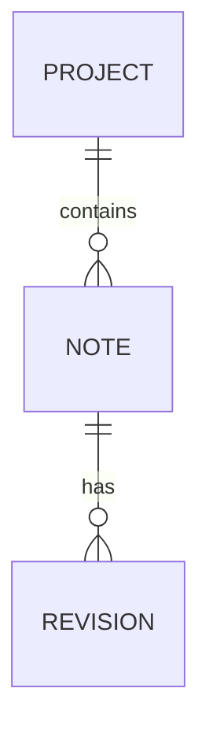

# Diagram workflows with Mermaid

**Upcoming feature.** The public v0.49.0 release displays a `mermaid` fence as code. The diagram engine and centered viewer described below have been independently reviewed in development, but their open pull requests have not been released. A further viewer revision is in progress. Use this chapter to prepare documents and understand the intended workflow; confirm your installed version before expecting its controls.

## Write a diagram as ordinary Markdown

A Mermaid diagram is a fenced block whose language is `mermaid`. Its definition stays in the document, so a teammate can review or version it without an extra diagram file. Keep one purpose per diagram and introduce it in the surrounding prose.

The following interactive examples are **rendered examples in this web guide**. Their zoom, pan, Fit All, and browser-viewport maximize controls belong to the guide. They are not screenshots or evidence that the same controls already ship in MIB.

<!-- diagram:workflow -->

Use a flowchart to show a small decision or process. Short labels leave room for arrows and make a diagram easier to inspect in a narrow reading column. Try this guide's zoom buttons, drag to pan, and **Fit All** to restore the complete view. Maximizing the guide example fills the browser content area; Esc restores it.

## Name the diagram

Give a diagram a safe, meaningful title in its Mermaid front matter:

````markdown

````

The reviewed MIB viewer uses a valid front-matter title first, then the rendered diagram's accessible title where available, then a fallback such as **Diagram 1**. Keep title metadata inside the Mermaid fence. It is separate from front matter belonging to the surrounding Markdown document.

An accessible title can also be supplied with Mermaid's supported `accTitle:` declaration. For example, after `flowchart TB`, add `accTitle: Review workflow` on its own line. Do not put HTML in a title or label to obtain formatting.

## Read the centered MIB frame

In the reviewed development design, each diagram has a subtly bordered, padded frame. Its name is at the top left and its maximize/restore control is at the far right. The inline frame fits the diagram's intrinsic content up to the available preview column; a small chart stays small and centered.

The diagram body and source overflow remain contained. Opening side panels or changing the window can change the effective reading column. A large diagram should not force the whole document wider than the app window. Read the restored viewer at its current available width rather than expecting the old pixel width to survive a layout change.

## Keep Source beside the result

The reviewed frame has a **Source** disclosure in its footer. It starts collapsed and is independent for each diagram. Opening it adds the exact, read-only, syntax-highlighted Mermaid definition **below the still-visible diagram**. It is useful for comparing a label with the text that generated it.

Long source lines scroll inside the frame. Editing still happens in document EDIT mode. Source disclosure is an inspection tool; it does not create a second editable copy or rewrite your Markdown.

The next viewer revision proposes actions and source access that appear when hovering the relevant viewer, together with Fit All, zoom, and pan. That revision remains upcoming. The original reviewed footer design and the proposed hover behavior are different development stages, not two preferences that v0.49.0 already offers.

## Maximize, restore, and keep your place

Use the frame's maximize control to inspect the whole frame, including Source if it is open. The reviewed MIB expansion fills the **app's content viewport**. It is distinct from macOS or browser fullscreen.

Restore with the same control or Esc when no active search/menu owns Escape. The viewer restores focus and reading position, retains each disclosure choice, and preserves source scrolling where the new bounds allow. If Find is active, dismiss its interaction before expecting Escape to restore the viewer.

Keyboard users can Tab to the controls and activate them with Enter or Space as appropriate. When expanded, the rest of the document is kept out of the active interaction. Restore before moving to a different part of the document.

## Find a label or its original source

Use document Find to locate text in a diagram or its source. When a source match needs to be shown, the viewer reveals Source while keeping the diagram visible. Search can still find a long title even when the header normally truncates it.

Move between matches to check the actual context. Controls such as the footer's **Source** label are interface text, rather than content to search. When a source change is needed, use the app's source-navigation workflow; double-clicking a disclosure control is not an editing shortcut.

## Choose the right diagram

A sequence diagram is good for request order and responsibilities. Name participants by their role, and keep transport detail out of the drawing unless it explains the point.

<!-- diagram:sequence -->

A user journey records tasks and their scores. Repeated words can be legitimate, so do not remove repeated labels merely to make a drawing appear less crowded. The upcoming typography work includes a correction for duplicated journey-label painting, readable dark labels, long-text wrapping, and mixed-script ordering.

<!-- diagram:journey -->

For data relationships, start with a small ER diagram and expand it only after the cardinalities are clear:

````markdown

````

Use separate diagrams for an architecture overview, a request exchange, and a project schedule. One drawing containing all three usually becomes harder to maintain than the document around it.

## Reviewed family coverage

The selected development engine is **Mermaid 11.17.2**. Its inventory distinguishes 38 loader routes from 34 canonical families/grammars; aliases and layouts are not additional families. The following is a compatibility summary for that development build, not a promise about every upstream Mermaid version or every feature of a grammar.

| Group | Families or grammars in the reviewed build |
| --- | --- |
| Core diagram syntax | Flowchart, sequence, class, canonical state, ER, journey, Gantt, pie, quadrant, requirement, GitGraph |
| Additional stable syntax | Kanban, event modeling |
| Experimental | C4, mindmap, timeline |
| Beta | Sankey, XY chart, block, packet, architecture, swimlane, radar, treeView, Ishikawa, Venn, treemap, Wardley, Cynefin |
| Railroad grammars | Railroad, EBNF, ABNF, PEG variants, all beta |
| Utility | `info` |

“Stable syntax” describes the selected syntax classification, not a guarantee that the upstream API will never change. Use the exact keyword supported by the pinned engine; some families require a `-beta` suffix. When sharing a less common family, also test it in the renderer your recipients use.

The audited **tidy-tree** layout is available within bounded limits. **ELK**, **ZenUML**, external icon-pack catalogs, and newer-only **agentflow/usecase** are excluded from the selected development package. Legacy state/dagre-d3 is a known broken route; use canonical `stateDiagram-v2`. Built-in architecture vector icons are separate from external icon packs.

## Write for international readers

Use real Thai, Japanese, and mixed-script labels early, rather than adding them after a diagram is finished. Keep Thai reading text in a looped face, leave enough vertical room for marks, and test long labels with the actual preview font preset. Do not use text encoded as HTML or `<br>` tags as a wrapping workaround: the diagram source policy rejects raw or encoded markup.

The upcoming renderer waits for fonts before measuring and reflows affected layouts when typography changes. Generated default colors have been checked across light/dark appearances. Authored colors remain your responsibility: a custom fill and text color can still create low contrast. C4 can have readable connector/label crossings in the upstream layout; it is not a collision-free diagramming engine.

## Errors, bounds, and recovery

A malformed or unsupported block should produce a local explanation with usable original source; valid neighboring diagrams remain useful. Start diagnosis with one small fence, remove optional configuration, and add it back one change at a time. Check the language keyword, quotes, punctuation, and the chosen engine version.

The reviewed renderer limits a document to 20 Mermaid blocks and applies other source/complexity limits. Large or adversarial input can be rejected deliberately. Split a large diagram by topic instead of expecting unlimited canvas size. Network content, interactive callbacks, host-security overrides, and arbitrary injected HTML are outside the supported subset.

After a major edit, inspect the diagram, its Source, the light/dark result, and its neighboring document text. Integration and the follow-up viewer controls are still being revised; this guide will move Mermaid into the released section when an actual public app release includes it.
