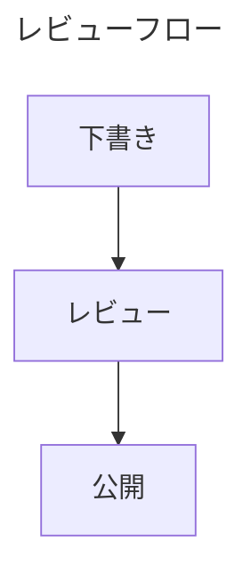
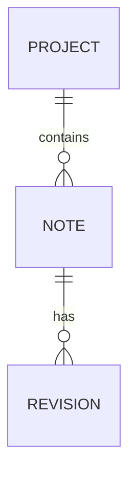

# Mermaid で図を扱う

**今後の機能です。** 公開版 v0.49.0 は `mermaid` フェンスをコードとして表示します。ここで説明するエンジンと中央配置のビューアーは開発版で独立レビュー済みですが、プルリクエストは未マージで、公開リリースには含まれていません。さらに次のビューアー改訂が進んでいます。文書の準備に役立てつつ、操作を期待する前にインストール済みバージョンを確認してください。

## 通常の Markdown として図を書く

Mermaid は言語を `mermaid` にしたコードフェンスで記述します。定義が文書に残るので、別の作図ファイルなしに変更をレビューし、バージョン管理できます。一つの図に一つの目的を持たせ、周囲の文章でその意味を説明します。

以下の操作できる図は **この Web ガイド内で描画した例**です。ズーム、パン、Fit All、ブラウザー領域への最大化はガイドの操作です。スクリーンショットでも、公開済み MIB に同じ操作が搭載された証拠でもありません。

<!-- diagram:workflow -->

フローチャートは短い手順や判断に向いています。ラベルを短くすると矢印の余地ができ、狭い読み幅でも確認しやすくなります。この例ではボタンでズームし、ドラッグで移動し、**Fit All** で全体へ戻せます。ガイドの最大化はブラウザーのコンテンツ領域を使い、Esc で復元します。

## 図に名前を付ける

Mermaid の front matter に、意味の明確な安全な文字列のタイトルを付けます。

````markdown

````

レビュー済み MIB ビューアーは、有効な front matter タイトル、描画された図のアクセシブルなタイトル、**Diagram 1** のような代替名の順で選びます。図のメタデータは Mermaid フェンスの内側に置きます。Markdown 文書全体の front matter とは別です。

Mermaid が対応する位置に `accTitle:` を書いてアクセシブルなタイトルを指定することもできます。たとえば `flowchart TB` の次の行に `accTitle: レビューフロー` と記述します。装飾のためにタイトルやラベルへ HTML を入れないでください。

## MIB の中央配置フレームを読む

レビュー済み開発デザインは、細い境界線と余白のあるフレームを使います。名前が左上、最大化・復元の操作が右端です。インラインの幅は図本来の内容に合わせ、利用可能なプレビュー列を上限にするため、小さい図は中央に小さく収まります。

図やソースのはみ出しはフレーム内に収めます。サイドパネルやウィンドウの変更で実際の読み幅も変わります。大きな図が文書全体をウィンドウの外へ押し広げることは想定していません。復元時は現在の領域に合わせ、以前と同じピクセル幅が続くとは考えないでください。

## Source と結果を一緒に見る

レビュー済みフレームでは、下部に **Source** の開閉部があります。初期状態は閉じ、図ごとに独立しています。開くと、正確な元の Mermaid 定義を、読み取り専用・構文強調付きで **図を残したまま、その下に** 表示します。ラベルと定義を照合するのに便利です。

長いソース行はフレーム内で横スクロールします。編集は文書の EDIT で行います。Source は確認用で、別の編集可能コピーを作ったり、Markdown を書き換えたりしません。

次の改訂では、対象ビューアーにポインターを重ねたときに操作や Source を表示し、Fit All、ズーム、パンを加える案が進んでいます。これも今後の機能です。レビュー済みの下部 Source と、提案中のホバー動作は異なる開発段階であり、v0.49.0 の二つの選択肢ではありません。

## 最大化して元の位置へ戻る

フレームの最大化で、開いている Source も含む全体を確認できます。レビュー済み MIB の拡大先は **アプリのコンテンツ領域**です。OS やブラウザーのフルスクリーンとは別です。

同じ操作か、検索・メニューが Escape を使っていない状態で Esc を押して復元します。フォーカス、読む位置、各図の Source 状態を戻し、ソースのスクロール位置は新しい境界が許す範囲で保ちます。Find を操作中なら、先にその操作を終了してください。

キーボードでは Tab で操作へ移り、必要に応じて Enter または Space で実行します。拡大中は文書の他の部分が操作対象から外れます。別の場所へ進む前に復元してください。

## ラベルと元のソースを検索する

文書の Find で図やソースの文字列を検索します。ソースの一致を見せる必要があれば、図を残したまま Source が開きます。通常は省略される長いタイトルも検索対象になります。

一致を移動して実際の文脈を確認してください。下部の **Source** などの操作名は UI であり、文書の検索内容ではありません。変更にはソースへ移る操作を使います。開閉部のダブルクリックは文書編集のショートカットではありません。

## 内容に合う図を選ぶ

シーケンス図は要求の順序や責務に向いています。参加者は役割で名付け、通信の細部は説明に必要なものだけにします。

<!-- diagram:sequence -->

ユーザージャーニーはタスクと評価を記録します。同じ語の繰り返しが正しい場合もあるため、見た目だけの理由で消さないでください。今後の文字組み対応には journey ラベルの二重描画、暗色時の可読性、長文の折返し、複数文字体系の順序の修正が含まれます。

<!-- diagram:journey -->

データの関連は小さな ER 図から始め、多重度が明確になってから広げます。

````markdown

````

アーキテクチャ概要、リクエスト交換、スケジュールは別々の図に分けます。すべてを一枚へ詰め込むと、周囲の文書より図の保守が難しくなりがちです。

## レビュー済みの図の範囲

選択されている開発エンジンは **Mermaid 11.17.2** です。38 のローダールートと、34 の正規ファミリー・文法を区別しています。別名やレイアウトは別ファミリーには数えません。次はその開発版の要約で、すべての upstream バージョンや文法内の全機能を保証する表ではありません。

| 分類 | レビューしたビルドのファミリー・文法 |
| --- | --- |
| 基本構文 | Flowchart、sequence、class、canonical state、ER、journey、Gantt、pie、quadrant、requirement、GitGraph |
| その他の安定構文 | Kanban、event modeling |
| 実験的 | C4、mindmap、timeline |
| Beta | Sankey、XY chart、block、packet、architecture、swimlane、radar、treeView、Ishikawa、Venn、treemap、Wardley、Cynefin |
| Railroad 文法 | Railroad、EBNF、ABNF、PEG。いずれも beta |
| ユーティリティー | `info` |

安定構文という分類は、upstream API が変わらないという約束ではありません。選択エンジンに合う正確なキーワードを使ってください。一部は `-beta` 接尾辞が必要です。珍しい種類を共有するときは受け手のレンダラーでも試します。

監査済みの **tidy-tree** は制限付きで利用できます。**ELK**、**ZenUML**、外部アイコンパックのカタログ、新しいバージョンだけにある **agentflow/usecase** は選択パッケージに含まれません。legacy state/dagre-d3 は既知の不具合があるため、正規の `stateDiagram-v2` を使います。architecture の組込みベクターアイコンは外部パックとは別です。

## 多言語の読者に向けて書く

タイ語、日本語、混在ラベルを初期から使ってください。タイ語の読みテキストにはループ付き書体を使い、結合記号の縦の余地を残し、実際のプレビュープリセットで長いラベルを確認します。折返し対策として HTML や `<br>` を使わないでください。ソース方針は、生のマークアップもエンコードされたものも拒否します。

今後のレンダラーはフォントを待って測定し、文字設定が変わると対象レイアウトを再計算します。生成される既定色は明暗両方で検査されていますが、著者が指定した色のコントラストは別途確認が必要です。C4 では読めるラベルと接続線が交差する upstream の制約があり、交差が一切ない作図エンジンではありません。

## エラー・制限・復帰

不正または未対応のブロックは、その場所に説明と読める元ソースを残し、正常な隣の図を使える状態に保つことを目指しています。診断は小さな一つのフェンスから始め、追加設定を外して一つずつ戻します。キーワード、引用符、記号、エンジンのバージョンを確認します。

レビュー済みレンダラーは一文書につき Mermaid を 20 ブロックまでとし、ほかにも長さ・複雑さを制限します。巨大または不正な入力の拒否は意図された場合があります。無制限のキャンバスを期待せず、主題ごとに分けてください。ネットワーク内容、実行可能な callback、host の安全性設定の上書き、任意 HTML は対応範囲外です。

大きな変更の後は、図、Source、明暗両モード、周囲の文書を確認します。統合と次の操作改訂はまだ調整中です。実際の公開リリースに入った時点で、このガイドも公開済み機能の説明へ移します。
