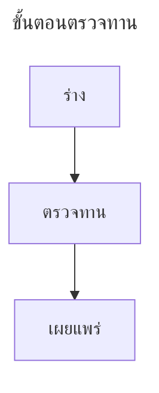
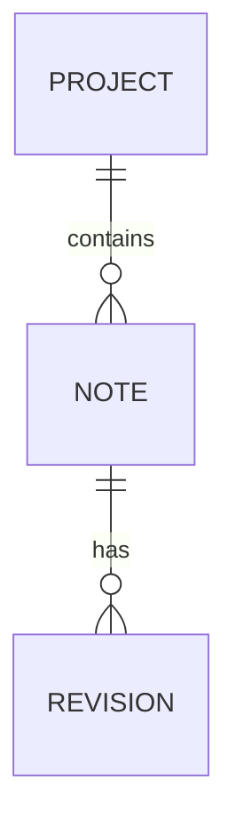

# สร้างและอ่านแผนภาพด้วย Mermaid

**ฟีเจอร์ที่จะตามมา** รุ่นสาธารณะ v0.49.0 แสดง fence `mermaid` เป็นโค้ด ระบบแผนภาพและกรอบอ่านที่อธิบายด้านล่างผ่านการตรวจทานอิสระในรุ่นพัฒนาแล้ว แต่ pull request ยังเปิดอยู่และยังไม่เผยแพร่ อีกทั้งมีการปรับ viewer รอบถัดไป ใช้บทนี้เตรียมเอกสารและทำความเข้าใจเวิร์กโฟลว์ พร้อมตรวจรุ่นที่ติดตั้งก่อนคาดหวังปุ่มเหล่านี้

## เขียนแผนภาพด้วย Markdown ปกติ

แผนภาพ Mermaid เป็น fenced block ที่ระบุภาษา `mermaid` นิยามอยู่ในเอกสาร จึงทบทวนการเปลี่ยนแปลงและเก็บใน version control ได้โดยไม่ต้องมีไฟล์วาดแยก ควรให้หนึ่งแผนภาพอธิบายหนึ่งเรื่อง และมีข้อความรอบข้างบอกจุดประสงค์

ตัวอย่างโต้ตอบด้านล่างเป็น **ตัวอย่างที่เรนเดอร์ในเว็บคู่มือนี้** ปุ่มย่อ ขยาย เลื่อน Fit All และขยายเต็มพื้นที่เบราว์เซอร์เป็นของเว็บไซต์ ไม่ใช่ภาพหน้าจอหรือหลักฐานว่า MIB รุ่นเผยแพร่มีปุ่มเหล่านี้แล้ว

<!-- diagram:workflow -->

ใช้ flowchart อธิบายกระบวนการหรือการตัดสินใจเล็ก ๆ ป้ายข้อความสั้นทำให้ลูกศรมีพื้นที่และอ่านในคอลัมน์แคบได้ง่าย ลองปุ่ม zoom ลากเพื่อเลื่อน และกด **Fit All** เพื่อกลับมาดูทั้งแผนภาพ เมื่อขยายตัวอย่างในเว็บ กรอบจะเต็มพื้นที่เนื้อหาเบราว์เซอร์ กด Esc เพื่อคืนขนาด

## ตั้งชื่อแผนภาพ

ใส่ชื่อที่สื่อความหมายและเป็นข้อความปลอดภัยใน front matter ของ Mermaid

````markdown

````

Viewer ที่ผ่านการตรวจทานจะใช้ชื่อ front matter ที่ถูกต้องก่อน ตามด้วยชื่อเพื่อการเข้าถึงจากแผนภาพที่เรนเดอร์ และใช้ชื่อสำรองอย่าง **Diagram 1** หากไม่มีชื่อ เก็บ metadata นี้ไว้ภายใน Mermaid fence ซึ่งเป็นคนละส่วนกับ front matter ของเอกสาร Markdown ทั้งไฟล์

ตั้งชื่อเพื่อการเข้าถึงด้วย `accTitle:` ในตำแหน่งที่ Mermaid รองรับได้ เช่น เพิ่ม `accTitle: ขั้นตอนตรวจทาน` เป็นบรรทัดถัดจาก `flowchart TB` อย่าใส่ HTML ในชื่อหรือป้ายข้อความเพื่อบังคับรูปแบบ

## อ่านกรอบแผนภาพของ MIB

การออกแบบรุ่นพัฒนาที่ผ่านการตรวจทานใช้กรอบมีเส้นขอบบางและ padding ชื่ออยู่ซ้ายบน ส่วนปุ่มขยายหรือคืนขนาดอยู่ขวาสุด กรอบในเอกสารปรับตามขนาดเนื้อหาแผนภาพ แต่ไม่เกินคอลัมน์พรีวิวที่มีอยู่ แผนภาพเล็กจึงยังเล็กและอยู่กึ่งกลาง

ส่วนที่ล้นของแผนภาพและต้นฉบับถูกจำกัดอยู่ในกรอบ การเปิดแผงด้านข้างหรือเปลี่ยนขนาดหน้าต่างทำให้ความกว้างที่มีจริงเปลี่ยนได้ แผนภาพใหญ่ไม่ควรดันทั้งเอกสารให้กว้างเกินหน้าต่าง เมื่อคืนขนาดให้ยึดพื้นที่ปัจจุบัน ไม่คาดหวังจำนวนพิกเซลเดิมหลังจัดหน้าต่างใหม่

## ดู Source พร้อมผลลัพธ์

กรอบที่ผ่านการตรวจทานมี **Source** แบบเปิดปิดได้ที่ส่วนท้าย เริ่มจากปิดและจำสถานะแยกแต่ละแผนภาพ เมื่อเปิดจะแสดง Mermaid ต้นฉบับจริงแบบอ่านอย่างเดียว พร้อมสีไวยากรณ์ **ใต้แผนภาพที่ยังมองเห็นอยู่** จึงเปรียบเทียบชื่อหรือป้ายกับข้อความที่สร้างมันได้

บรรทัดต้นฉบับยาวเลื่อนภายในกรอบ การแก้ไขยังต้องทำใน EDIT ของเอกสาร Source ใช้ตรวจสอบ ไม่ได้สร้างสำเนาที่แก้ไขแยกหรือเขียน Markdown ใหม่

Viewer รอบถัดไปเสนอให้ปุ่มการทำงานและการเข้าถึง Source ปรากฏเมื่อชี้เมาส์เหนือ viewer นั้น พร้อม Fit All, zoom และ pan ทั้งหมดยังเป็นงานที่จะตามมา แบบ Source ที่ส่วนท้ายซึ่งตรวจทานแล้ว กับพฤติกรรม hover ที่เสนอใหม่เป็นคนละช่วงพัฒนา ไม่ใช่ตัวเลือกสองแบบที่ v0.49.0 มีให้เลือก

## ขยาย คืนขนาด และรักษาตำแหน่ง

ใช้ปุ่มขยายของกรอบเพื่อดูทั้งแผนภาพและ Source ที่เปิดอยู่ การขยายใน MIB แบบที่ตรวจทานแล้วเติม **พื้นที่เนื้อหาของแอป** ซึ่งต่างจาก fullscreen ของระบบปฏิบัติการหรือเบราว์เซอร์

คืนขนาดด้วยปุ่มเดิม หรือ Esc เมื่อไม่มีแผงค้นหาหรือเมนูรับปุ่มอยู่ Viewer จะคืนโฟกัสและตำแหน่งอ่าน คงสถานะ Source ของแต่ละกรอบ และรักษาตำแหน่งเลื่อนเท่าที่ขอบเขตใหม่อนุญาต หากกำลังใช้ Find ให้จบการใช้งานนั้นก่อนคาดหวังว่า Esc จะคืน viewer

ใช้ Tab ไปยังปุ่ม แล้วกด Enter หรือ Space ตามชนิดปุ่ม เมื่อขยาย ส่วนอื่นของเอกสารจะอยู่นอกการโต้ตอบที่ใช้งานอยู่ ควรคืนขนาดก่อนย้ายไปส่วนอื่น

## ค้นหาป้ายและต้นฉบับ

ใช้ Find ของเอกสารหาข้อความในแผนภาพหรือ Source เมื่อจำเป็นต้องแสดงผลค้นหาใน Source กรอบจะเปิดต้นฉบับโดยคงแผนภาพไว้ ชื่อยาวที่ปกติย่อไว้ใน header ยังสามารถค้นหาได้

เลื่อนผลค้นหาเพื่อตรวจบริบทจริง ชื่อปุ่ม เช่น **Source** ที่ส่วนท้ายเป็นข้อความของ UI ไม่ใช่เนื้อหาเอกสาร หากต้องแก้ต้นฉบับ ให้ใช้เวิร์กโฟลว์นำทางไป EDIT การดับเบิลคลิกตัวเปิดปิด Source ไม่ใช่คีย์ลัดแก้เอกสาร

## เลือกชนิดแผนภาพให้ตรงเรื่อง

Sequence diagram เหมาะกับลำดับคำขอและหน้าที่ของแต่ละฝ่าย ตั้งชื่อผู้ร่วมตามบทบาท และใส่รายละเอียดการรับส่งเฉพาะที่จำเป็นต่อเรื่อง

<!-- diagram:sequence -->

User journey บันทึกงานและคะแนน ชื่อซ้ำอาจตั้งใจใช้ จึงไม่ควรลบคำซ้ำเพียงเพื่อให้ภาพดูโล่ง งาน typography ที่จะตามมาแก้การวาดป้าย journey ซ้อนสองครั้ง ความชัดในโหมดมืด การตัดบรรทัดยาว และลำดับข้อความหลายระบบอักษร

<!-- diagram:journey -->

สำหรับความสัมพันธ์ข้อมูล เริ่มด้วย ER diagram เล็ก ๆ แล้วเพิ่มรายละเอียดหลังจำนวนความสัมพันธ์ชัดเจน

````markdown

````

แยกภาพรวมสถาปัตยกรรม ลำดับคำขอ และกำหนดการโครงการเป็นคนละแผนภาพ การรวมทุกอย่างในภาพเดียวมักดูแลยากกว่าเอกสารที่ใช้อธิบาย

## ชนิดที่ผ่านการตรวจทาน

รุ่นพัฒนาเลือก **Mermaid 11.17.2** โดยแยก 38 loader routes ออกจาก 34 ตระกูลหรือ grammar หลัก ชื่อเรียกทางเลือกและ layout ไม่นับเป็นตระกูลเพิ่ม ตารางนี้สรุปความเข้ากันได้ของรุ่นนั้น ไม่รับประกันทุกเวอร์ชัน upstream หรือทุกความสามารถย่อยของ grammar

| กลุ่ม | ตระกูลหรือ grammar ในชุดที่ตรวจทาน |
| --- | --- |
| ไวยากรณ์หลัก | Flowchart, sequence, class, canonical state, ER, journey, Gantt, pie, quadrant, requirement, GitGraph |
| ไวยากรณ์เสถียรเพิ่มเติม | Kanban, event modeling |
| ทดลอง | C4, mindmap, timeline |
| Beta | Sankey, XY chart, block, packet, architecture, swimlane, radar, treeView, Ishikawa, Venn, treemap, Wardley, Cynefin |
| Railroad grammar | Railroad, EBNF, ABNF, PEG ซึ่งเป็น beta |
| เครื่องมือข้อมูล | `info` |

คำว่าไวยากรณ์เสถียรเป็นการจัดประเภทของชุดที่เลือก ไม่ใช่คำรับประกันว่า API ของ upstream จะไม่เปลี่ยน ใช้ keyword ให้ตรงกับ engine บางชนิดต้องมีท้ายชื่อ `-beta` เมื่อต้องส่งชนิดที่ไม่คุ้นเคย ให้ลองใน renderer ของผู้รับด้วย

มี layout **tidy-tree** ที่ผ่านการตรวจสอบและมีขอบเขตจำกัด ส่วน **ELK**, **ZenUML**, แค็ตตาล็อกไอคอนภายนอก และ **agentflow/usecase** ที่มีเฉพาะเวอร์ชันใหม่กว่ายังไม่รวมในชุดนี้ เส้นทาง legacy state/dagre-d3 มีปัญหาที่ทราบแล้ว ให้ใช้ `stateDiagram-v2` แบบหลัก ไอคอนเวกเตอร์ในตัวของ architecture เป็นคนละส่วนกับชุดไอคอนภายนอก

## เขียนให้ผู้อ่านหลายภาษา

ใส่ป้ายไทย ญี่ปุ่น และข้อความผสมตั้งแต่เริ่มงาน ใช้ฟอนต์ไทยมีหัวสำหรับการอ่าน เว้นความสูงให้สระและวรรณยุกต์ และลองป้ายยาวด้วย preset ที่ใช้จริง อย่าใช้ข้อความ HTML หรือ `<br>` แก้การตัดบรรทัด เพราะนโยบายต้นฉบับปฏิเสธ markup ทั้งแบบตรงและแบบเข้ารหัส

Renderer ที่จะตามมารอโหลดฟอนต์ก่อนวัดขนาด และจัด layout ที่เกี่ยวข้องใหม่เมื่อ typography เปลี่ยน สีเริ่มต้นที่สร้างให้ผ่านการตรวจทั้งสว่างและมืด แต่สีที่ผู้เขียนกำหนดเองยังต้องตรวจคอนทราสต์เอง Layout ของ C4 อาจมีเส้นตัดผ่านป้ายที่ยังอ่านได้ ไม่ใช่ระบบจัดเส้นที่รับประกันว่าไม่มีการตัดกัน

## ข้อผิดพลาด ขอบเขต และการกู้คืน

บล็อกที่ผิดหรือไม่รองรับควรมีคำอธิบายเฉพาะจุดและยังอ่านต้นฉบับได้ โดยไม่ทำให้แผนภาพข้างเคียงที่ถูกต้องเสีย เริ่มวินิจฉัยด้วย fence เล็กเพียงอันเดียว เอาค่าตั้งเสริมออกแล้วใส่กลับทีละอย่าง ตรวจ keyword เครื่องหมายคำพูด วรรคตอน และเวอร์ชัน

ชุดที่ตรวจทานจำกัด Mermaid ไว้ 20 บล็อกต่อเอกสาร และมีข้อจำกัดความยาวหรือความซับซ้อนอื่น อินพุตใหญ่หรือผิดรูปอาจถูกปฏิเสธโดยตั้งใจ แบ่งแผนภาพตามหัวข้อแทนการคาดหวังพื้นที่ไม่จำกัด เนื้อหาจากเครือข่าย callback ที่ทำงานได้ การเปลี่ยนกฎความปลอดภัยของ host และ HTML ที่แทรกอิสระไม่อยู่ในส่วนที่รองรับ

หลังแก้มาก ๆ ให้ตรวจภาพ Source โหมดสว่าง/มืด และข้อความรอบข้าง งานรวมระบบกับปุ่มรอบถัดไปยังอยู่ระหว่างปรับ บทนี้จะเปลี่ยนสถานะเป็นฟีเจอร์เผยแพร่เมื่อมีรุ่นสาธารณะที่รวมความสามารถจริง
